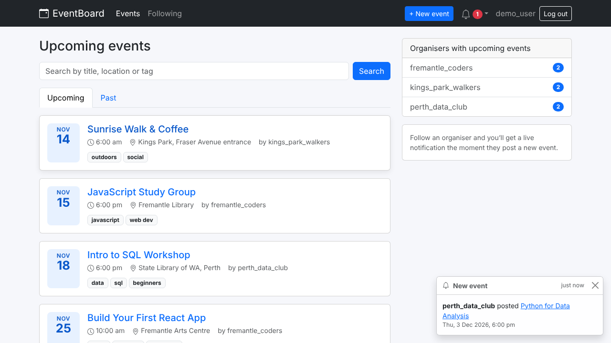
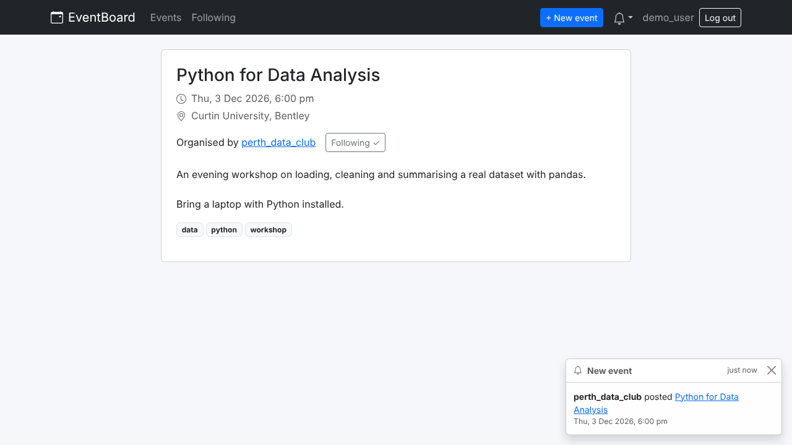

# EventBoard


EventBoard is a community events platform where users can follow organisers and receive **live notifications as soon as new events are posted**, without needing to refresh the page.

**Live demo:** https://eventboard-8nw1.onrender.com/ · Log in with `demo_user` / `demo1234`

*The app uses free hosting, so the first load may take up to a minute while the server starts.*



## Features

- **Real-time notifications** sent to followers when an organiser posts an event, with a saved notification history for users who are offline
- **Event listings** with dates and locations, including upcoming and past events, with search by title, location or tag
- **User accounts** with hashed passwords and sessions that persist across server restarts
- **Role-based permissions:** organisers can manage their own events, admins can remove any event, and visitors can browse without posting
- **Organiser profiles** showing follower counts, with a layout that adapts to mobile screens



## Tech stack

- **Front end:** React, React Router, React-Bootstrap, Vite
- **Back end:** Node.js, Express, Passport, express-session
- **Database:** MongoDB with Mongoose, hosted on MongoDB Atlas
- **Real-time communication:** Socket.IO
- **Testing and deployment:** Node test runner, GitHub Actions, Render

## How live notifications work

When a logged-in user visits the site, their browser establishes a Socket.IO connection with the server. The server verifies their login session and assigns the connection to a room linked to that user. This means notifications can reach all of their open tabs through the same room.

When an organiser creates an event, the server saves a notification in MongoDB for each of their followers. It then sends the notification to each follower's room, where it updates the notification bell and displays a pop-up without requiring a page refresh.

## Running locally

Requires Node.js 20 or later and MongoDB. You can use a local installation, Docker or a free MongoDB Atlas cluster.

```bash
npm run install:all
cp server/.env.example server/.env   # set MONGO_URI and SESSION_SECRET
npm run seed                         # optional demo data (password: demo1234)
npm run dev:server                   # API on port 3000
npm run dev:client                   # app on http://localhost:5173 (second terminal)